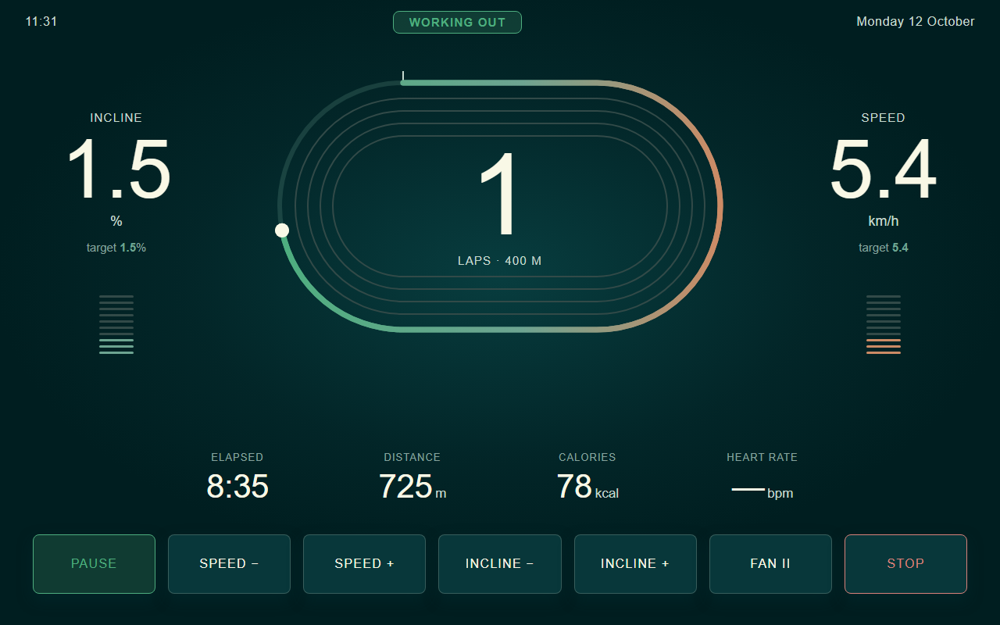
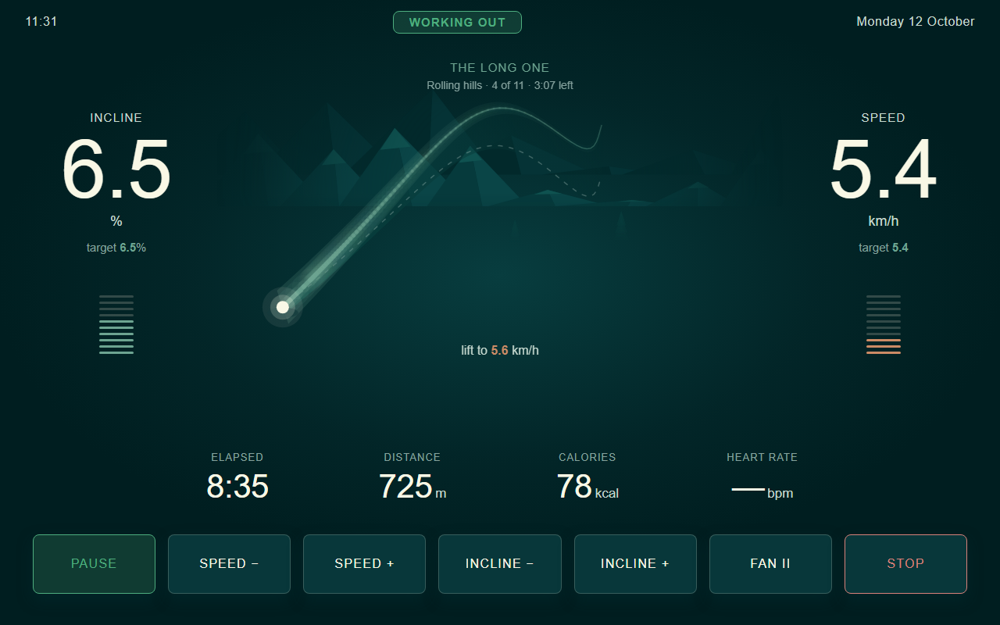

# Screenshots

1280×800, straight off the console. Mocked-up numbers, made-up names.

## A casual walk

A 400 m oval, lap count in the middle, in the TrailMate app's design: deep
teal, mountain green and copper, square corners, no glow.

## A guided walk

The oval is replaced by the ground ahead — the profile, where you are on it,
and the next segment. STRIDE moves the incline; "lift to 6.4 km/h" is only a
suggestion and the belt doesn't act on it.

## Settings

On the treadmill's own screen. No config files, no rebuild.

### Who walks
Everyone gets their own totals. Recording is per person, and can be linked to
a Home Assistant `person`.

### Heart rate
Bluetooth chest straps, using the standard heart rate service — the scan
filters on service UUID, not brand, so most straps work.

### Display
Kilometres or miles, and everything that comes with living with a screen
that's on all day. Units change every screen and everything published; the
board stays metric underneath either way.

### About
The board line is read over USB at startup.

## Welcome

Nobody is set up out of the box, so it offers a guest walk until you add
people.

